<div align="center">

# ⚡ TaskFlow — Full-Stack Task Manager

### A Production-Ready, Secure, Multi-Tenant Task Management Platform
*Built for the Syntecxhub Internship — Project 1*

[](https://github.com/chaitanyaverma-blockchain/Syntecxhub--Task-manager)
[](https://nodejs.org/)
[](https://react.dev/)
[](https://expressjs.com/)
[](https://www.mongodb.com/)
[](LICENSE)

[Features](#-key-features) • [Tech Stack](#-technology-stack) • [Architecture](#-architecture--data-flow) • [Quick Start](#-quick-start--local-setup) • [API Reference](#-api-endpoints) • [Security](#-security--data-isolation) • [Testing](#-automated-testing-suite)

</div>

---

## 🌟 Overview

**TaskFlow** is an enterprise-grade full-stack task management web application crafted with the MERN stack (MongoDB, Express, React, Node.js) and modern SaaS UI aesthetics. It features end-to-end user authentication, strict multi-tenant data isolation, real-time analytics aggregation, intuitive task organization (instant search, priority/status filtering, multi-attribute sorting), and seamless responsive design with zero-flash dark mode.

---

## ✨ Key Features

| Feature | Description |
| :--- | :--- |
| 🔐 **Dual Auth Protection** | Stateless JWT authentication delivered via **HttpOnly, SameSite cookies** (mitigating XSS) with Bearer token fallback for testing & APIs. |
| 🛡️ **Strict Multi-User Isolation** | Zero cross-tenant data leaks. Every database query, update, and deletion is cryptographically tied to the authenticated user ID. |
| 📊 **Dynamic Analytics Dashboard** | Real-time task statistics aggregated on-the-fly directly from MongoDB (Total Tasks, Pending, Completed, and High-Priority). |
| ⚡ **Full Task Lifecycle Management** | Complete CRUD functionality with inline status toggling, automatic strike-through styling, due-date calculation, and modal confirmations. |
| 🔍 **Search & Multi-Filter Engine** | Debounced real-time text search, status filters (`All`, `Pending`, `Completed`), priority filters (`Low`, `Medium`, `High`), and custom sorting. |
| 🌓 **Adaptive Light & Dark Theme** | Instant zero-flash theme persistence using CSS custom variables and system preference detection. |
| 📱 **Responsive SaaS Interface** | Fluid responsive design with mobile navigation drawer, collapsible sidebar, and custom CSS tokens. |

---

## 🛠 Technology Stack

```mermaid
graph LR
    subgraph Frontend [Client Layer: React 18 + Vite]
        UI[SaaS Component System]
        Router[React Router DOM v6]
        Context[Auth & Theme Context]
        AxiosClient[Axios Interceptors]
    end

    subgraph Security [Security & Middleware]
        Helmet[Helmet Security Headers]
        RateLimit[Express Rate Limiter]
        AuthMW[JWT Verification & HttpOnly Cookies]
        Validator[Schema Sanitizer]
    end

    subgraph Backend [Backend Layer: Express + Node.js]
        Express[Express REST API]
        Controllers[Auth & Task Controllers]
        ODM[Mongoose ODM]
    end

    subgraph Storage [Database Engine]
        MongoDB[(MongoDB Database)]
    end

    UI --> Router --> Context --> AxiosClient
    AxiosClient -- HTTPS / Credentials --> Security
    Security --> Express --> Controllers --> ODM --> MongoDB
```



### **Frontend**
- **Core**: [React 18.3](https://react.dev/) + [Vite 6](https://vitejs.dev/)
- **Routing**: [React Router DOM v6](https://reactrouter.com/)
- **Styling**: Vanilla CSS Design System (Custom tokens, glassmorphism, responsive breakpoints at 360px, 768px, 1440px)
- **Icons**: [Lucide React](https://lucide.dev/)
- **HTTP**: [Axios](https://axios-http.com/) with global credentials and automatic error handling

### **Backend**
- **Runtime**: [Node.js](https://nodejs.org/) (v18+)
- **Server**: [Express.js](https://expressjs.com/) RESTful API
- **Database Engine**: [MongoDB](https://www.mongodb.com/) via [Mongoose ODM](https://mongoosejs.com/)
- **Security & Utilities**:
  - `bcryptjs` — Salted password hashing (cost factor 10)
  - `jsonwebtoken` — Signed JWT tokens
  - `cookie-parser` — Secure cookie handling
  - `helmet` — HTTP security headers (CSP, XSS, Frameguard)
  - `express-rate-limit` — Brute-force protection on auth endpoints
  - `cors` — Configured for strict origin and credentials validation

---

## 🏗 Directory Architecture

```plaintext
syntech-task-3/
├── client/                          # React + Vite Frontend
│   ├── public/                      # Static assets & favicon
│   ├── src/
│   │   ├── components/              # Modular UI Components
│   │   │   ├── ConfirmDialog.jsx    # Accessible confirmation modal
│   │   │   ├── Loader.jsx           # Clean spinner state
│   │   │   ├── Navbar.jsx           # Header bar with instant CTAs
│   │   │   ├── ProtectedRoute.jsx   # Client-side authentication guard
│   │   │   ├── Sidebar.jsx          # Collapsible desktop/mobile navigation
│   │   │   ├── StatCard.jsx         # Summary cards with live metrics
│   │   │   ├── TaskCard.jsx         # Interactive task card
│   │   │   ├── TaskFilters.jsx      # Search, filter pills & sort selects
│   │   │   ├── TaskForm.jsx         # Task creation/editing modal form
│   │   │   └── ThemeToggle.jsx      # Dark/Light mode toggle button
│   │   ├── context/                 # Global React Contexts
│   │   │   ├── AuthContext.jsx      # User session restoration & state
│   │   │   └── ThemeContext.jsx     # Dark mode provider & persistence
│   │   ├── pages/                   # Application Views
│   │   │   ├── Dashboard.jsx        # Analytics overview & recent activity
│   │   │   ├── Tasks.jsx            # Main task workspace & controls
│   │   │   ├── Login.jsx            # Authentication form with password reveal
│   │   │   ├── Signup.jsx           # Account creation with validation
│   │   │   └── NotFound.jsx         # Custom 404 page
│   │   ├── services/
│   │   │   └── api.js               # Centralized Axios instance
│   │   ├── utils/
│   │   │   └── dateUtils.js         # Date formatting & overdue helpers
│   │   ├── index.css                # Custom CSS design system tokens
│   │   ├── App.jsx                  # Route definitions
│   │   └── main.jsx                 # Entry point
│   ├── .env.example                 # Client environment template
│   └── vite.config.js               # Dev server & reverse proxy
│
├── server/                          # Express & Node.js Backend
│   ├── config/
│   │   └── db.js                    # MongoDB connection with retry logic
│   ├── controllers/
│   │   ├── authController.js        # Signup, login, logout, getMe
│   │   └── taskController.js        # User-isolated CRUD & metrics
│   ├── middleware/
│   │   ├── authMiddleware.js        # Dual JWT verification (Cookie/Bearer)
│   │   ├── errorHandler.js          # Centralized error handler
│   │   └── validateRequest.js       # Request validation & sanitization
│   ├── models/
│   │   ├── User.js                  # User schema with bcrypt hooks
│   │   └── Task.js                  # Task schema with user indexing
│   ├── routes/
│   │   ├── authRoutes.js            # Authentication routes with rate limiter
│   │   └── taskRoutes.js            # Protected task routes
│   ├── tests/
│   │   └── api.test.js              # Comprehensive Supertest suite
│   ├── .env.example                 # Server environment template
│   ├── app.js                       # Express middleware pipeline
│   └── server.js                    # Server bootstrap & graceful shutdown
│
├── scripts/
│   └── verify_persistence.js        # MongoDB direct persistence audit
├── package.json                     # Root orchestrator scripts
└── README.md                        # Documentation
```

---

## 🔒 Security & Data Isolation

### 1. HTTP-Only Cookie Authentication
- Authentication tokens are returned using `HttpOnly`, `SameSite: Lax` (or `None` in production with `Secure`) cookies.
- **Why this matters**: JavaScript cannot access the auth cookie, rendering cross-site scripting (XSS) token theft impossible.

### 2. Multi-User Isolation Guarantee
Every task query, mutation, and deletion checks ownership at the database level:
```javascript
// Strict ownership check in taskController.js
if (task.user.toString() !== req.user._id.toString()) {
  return res.status(403).json({
    success: false,
    message: 'Access forbidden: You do not own this task.'
  });
}
```

### 3. Password Security
- Passwords are encrypted before persisting to MongoDB using `bcryptjs` with 10 salt rounds.
- The `password` field has `{ select: false }` in the Mongoose schema, ensuring it is never leaked in queries.

---

## 🚀 Quick Start & Local Setup

### Prerequisites
- **Node.js** v18+ (Tested on v24.x)
- **npm** v9+ (Tested on v11.x)
- **MongoDB** running locally or via MongoDB Atlas

### 1. Clone Repository
```bash
git clone https://github.com/chaitanyaverma-blockchain/Syntecxhub--Task-manager.git
cd Syntecxhub--Task-manager
```

### 2. Install All Dependencies
One command installs dependencies across root, server, and client:
```bash
npm run install:all
```

### 3. Configure Environment Variables

**Server (`server/.env`)**:
```env
PORT=5000
NODE_ENV=development
MONGODB_URI=mongodb://127.0.0.1:27017/task_manager_db
JWT_SECRET=syntech_task_manager_super_secure_jwt_secret_key_2026_xyz
JWT_EXPIRES_IN=7d
CLIENT_URL=http://localhost:5173
```

**Client (`client/.env`)**:
```env
VITE_API_URL=http://localhost:5000/api
```

*(Pre-configured blueprints are available in `server/.env.example` and `client/.env.example`)*

### 4. Run Locally
Start both backend and frontend concurrently:
```bash
npm run dev
```

| Application | URL | Purpose |
| :--- | :--- | :--- |
| **Frontend** | [http://localhost:5173](http://localhost:5173) | Interactive Web Client |
| **Backend API** | [http://localhost:5000](http://localhost:5000) | REST API Service |
| **API Health Check** | [http://localhost:5000/api/health](http://localhost:5000/api/health) | Service Health Monitor |

---

## 📡 API Endpoints

### 🔐 Authentication (`/api/auth`)

| Method | Endpoint | Access | Description |
| :--- | :--- | :--- | :--- |
| `POST` | `/api/auth/signup` | Public | Register new user and issue auth cookie |
| `POST` | `/api/auth/login` | Public | Authenticate user and issue auth cookie |
| `GET` | `/api/auth/me` | Protected | Fetch current logged-in user profile |
| `POST` | `/api/auth/logout` | Protected | Invalidate auth cookie and clear session |

### 📋 Tasks (`/api/tasks`)

| Method | Endpoint | Access | Description |
| :--- | :--- | :--- | :--- |
| `GET` | `/api/tasks` | Protected | List tasks with search, filter, and sorting |
| `GET` | `/api/tasks/stats` | Protected | Aggregated dashboard task counts |
| `POST` | `/api/tasks` | Protected | Create a new task |
| `GET` | `/api/tasks/:id` | Protected | Get single task details |
| `PUT` | `/api/tasks/:id` | Protected | Update task title, description, priority, due date |
| `PATCH`| `/api/tasks/:id/status` | Protected | Toggle or set task status (`pending` / `completed`) |
| `DELETE`| `/api/tasks/:id` | Protected | Permanently remove a task |

---

## 🧪 Automated Testing Suite

The repository includes a comprehensive, automated integration and security test suite using Node's native test runner and **Supertest**:

```bash
# Run server test suite
npm test --prefix server
```

### Test Suite Execution Output
```plaintext
✔ 1. System Health Check (154ms)
▶ 2. Authentication Suite
  ✔ 2.1 Rejects signup with missing required fields (438ms)
  ✔ 2.2 Successfully registers User A (203ms)
  ✔ 2.3 Rejects duplicate email registration cleanly (23ms)
  ✔ 2.4 Rejects login with incorrect password (145ms)
  ✔ 2.5 Successfully logs in User A with valid credentials (136ms)
  ✔ 2.6 Rejects protected /api/auth/me without token (14ms)
  ✔ 2.7 Rejects protected /api/auth/me with invalid token (17ms)
  ✔ 2.8 Accesses /api/auth/me with valid Bearer token (30ms)
  ✔ 2.9 Accesses /api/auth/me with valid HttpOnly cookie (21ms)
✔ 2. Authentication Suite (1033ms)
▶ 3. Task CRUD and Multi-User Isolation Suite
  ✔ Setup: Authenticate User A and User B (272ms)
  ✔ 3.1 User A creates a task (28ms)
  ✔ 3.2 User B creates a task (22ms)
  ✔ 3.3 User A queries tasks and only sees their own tasks (31ms)
  ✔ 3.4 User B queries tasks and only sees their own tasks (23ms)
  ✔ 3.5 Security: User A CANNOT read User B task by ID (Returns 403) (23ms)
  ✔ 3.6 Security: User A CANNOT update User B task (Returns 42ms)
  ✔ 3.7 Security: User A CANNOT change status of User B task (Returns 403) (20ms)
  ✔ 3.8 Security: User A CANNOT delete User B task (Returns 403) (40ms)
  ✔ 3.9 User A updates their own task successfully (39ms)
  ✔ 3.10 User A marks their own task as completed (26ms)
  ✔ 3.11 User A gets updated dashboard statistics (102ms)
  ✔ 3.12 User A deletes their own task successfully (58ms)
  ✔ 3.13 Rejects malformed task ID (Returns 400) (21ms)
✔ 3. Task CRUD and Multi-User Isolation Suite (756ms)

ℹ tests 26 | pass 26 | fail 0 (100% Pass Rate)
```

### Database Persistence Audit
Run the standalone database persistence audit to verify direct MongoDB document writes:
```bash
npm run test:persistence
```

---

## 🚢 Deployment Guide

### Deploying Frontend (Vercel)
1. Link repository to [Vercel](https://vercel.com/).
2. Set root directory to `client`.
3. Set build command to `npm run build` and output directory to `dist`.
4. Configure environment variable: `VITE_API_URL=https://your-backend-domain.com/api`.

### Deploying Backend (Render / Railway)
1. Create a new Web Service pointing to `server/`.
2. Build command: `npm install`.
3. Start command: `node server.js`.
4. Add environment variables:
   - `NODE_ENV=production`
   - `PORT=5000`
   - `MONGODB_URI=mongodb+srv://<username>:<password>@cluster.mongodb.net/task_manager_db`
   - `JWT_SECRET=<64-byte-secure-random-string>`
   - `CLIENT_URL=https://your-frontend-domain.vercel.app`

---

## 👨‍💻 Author & Acknowledgments

- **Developer**: Chaitanya Verma ([@chaitanyaverma-blockchain](https://github.com/chaitanyaverma-blockchain))
- **Program**: Syntecxhub Internship — Project 1

---

## 📄 License

This project is licensed under the **MIT License**. See the [LICENSE](LICENSE) file for full details.
